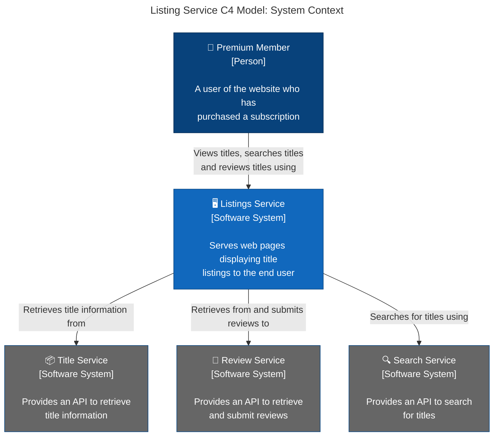

# C4 Model: System Context Diagram

This document presents the **System Context** level (Level 1) of the C4 model for the Listing Service, modeling human users, the target system boundary, supporting external systems, and applying custom styling to differentiate architecture roles.

## Complete C4 Diagram with Styling

