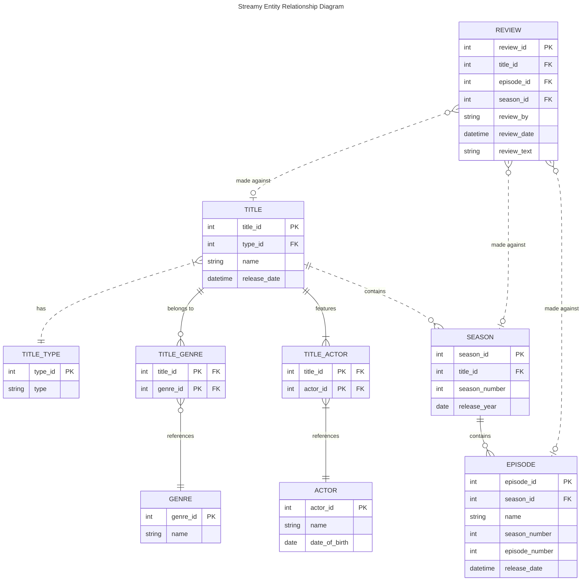

# Streamy Database Schema — Entity Relationship Diagram

This document models the relational database schema for the Streamy platform using Mermaid ERD syntax, including primary/foreign keys, column types, and all cardinality types (identifying vs. non-identifying relationships).

## Complete ERD with All Entities and Relationships

