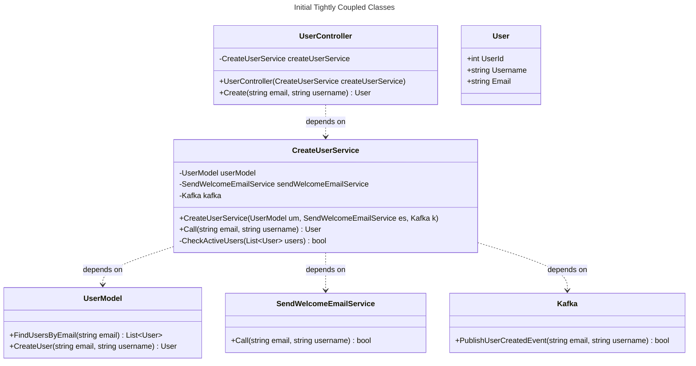
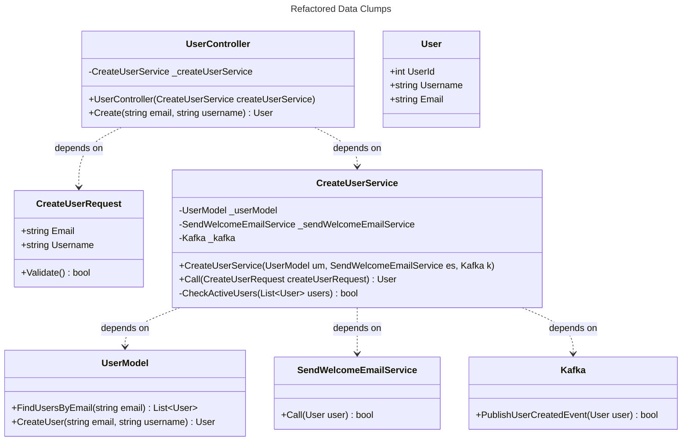
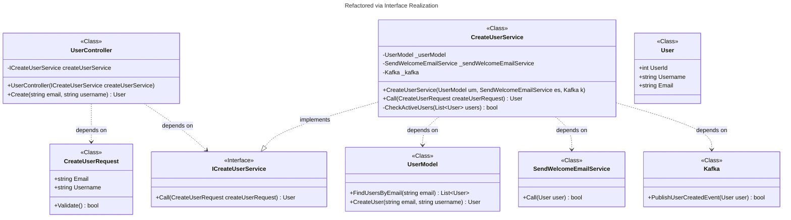

# UML Class Diagram Refactoring

This document models the refactoring of a tightly coupled user registration flow, addressing two common code smells: **Data Clumps** and **Tight Coupling**.

## Step 1: Initial Tightly Coupled Classes

## Step 2: Refactored Data Clumps

## Step 3: Refactored via Interface Realization

