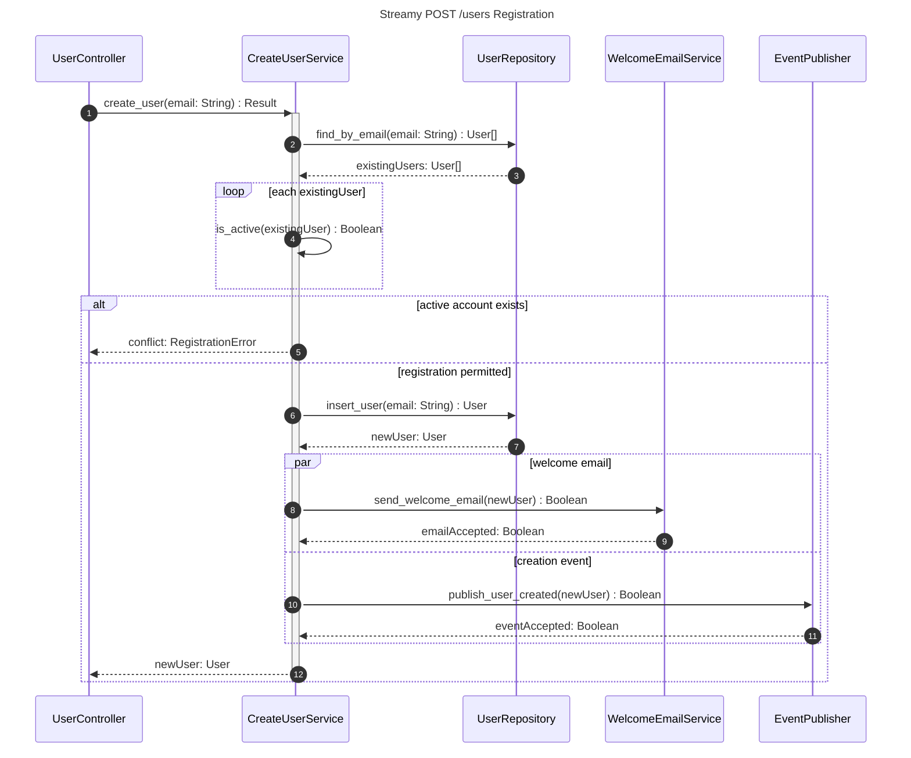

# Streamy Code-Level Sequence Diagram: POST /users Registration

This document models the code-level sequence for the Streamy POST /users account-registration scenario, covering method invocations, return types, activation bars, loops, alternatives, and concurrent branches.

## 1. Full Sequence Diagram

## 2. Architecture Analysis

### 2.1 Leaky Abstractions

Iterating over all matched users to identify active accounts may be inefficient. Consider a repository method such as `exists_active_by_email(email)`, supported by appropriate uniqueness rules.

### 2.2 Side-Effect Coupling

Sending email and publishing an event during registration can make retries and partial failures difficult. Consider an event-driven worker and, where needed, a transactional outbox for reliable delivery.

## 3. Verification

- ✅ Service activation begins at `C->>+S: create_user(...)` and ends at `deactivate S`.
- ✅ `loop`, `alt/else`, and `par/and` frames render with separate labels.
- ✅ Actual method signatures and return types are used throughout.