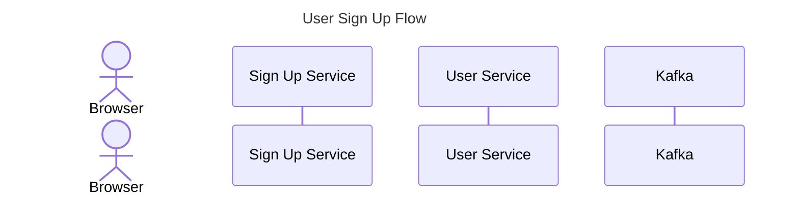
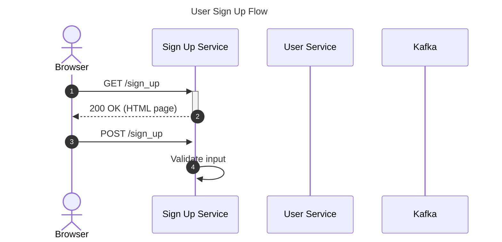
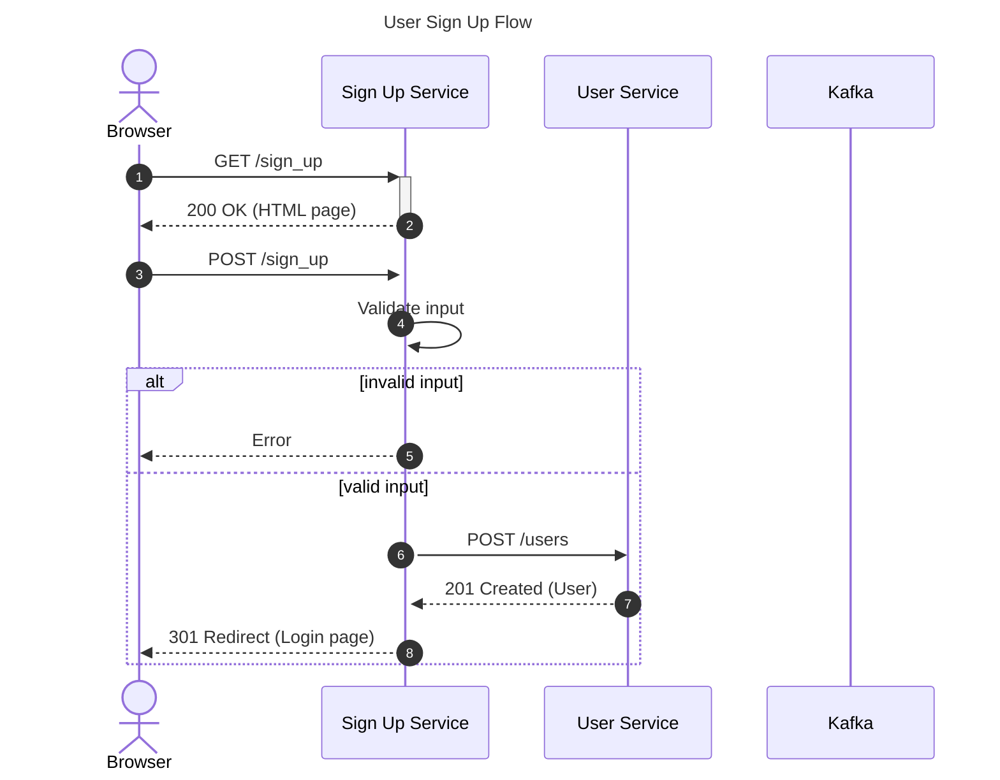
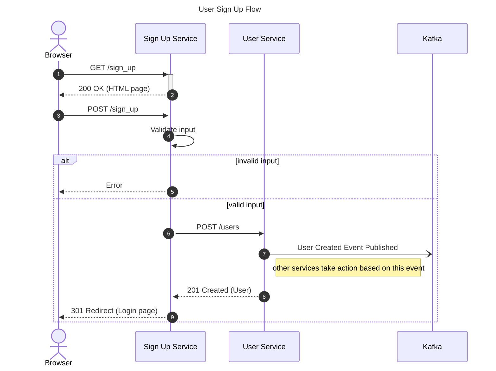

# User Sign Up Flow — Sequence Diagram

This document models the service and user interactions for the Streamy user sign-up flow, covering synchronous/asynchronous messaging, lifelines, activation blocks, branching paths, notes, sequence numbering, and dropdown menus.

## Step 1: Actors, Participants, and Sequence Numbering

## Step 2: Synchronous Messages and Activation Blocks

## Step 3: Branching Logic (Happy vs. Unhappy Paths)

## Step 4: Asynchronous Events, Notes, and Dropdown Links

