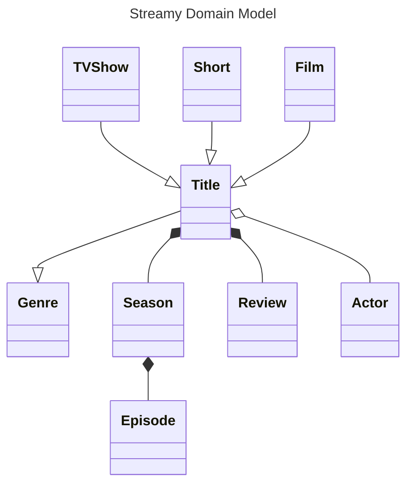
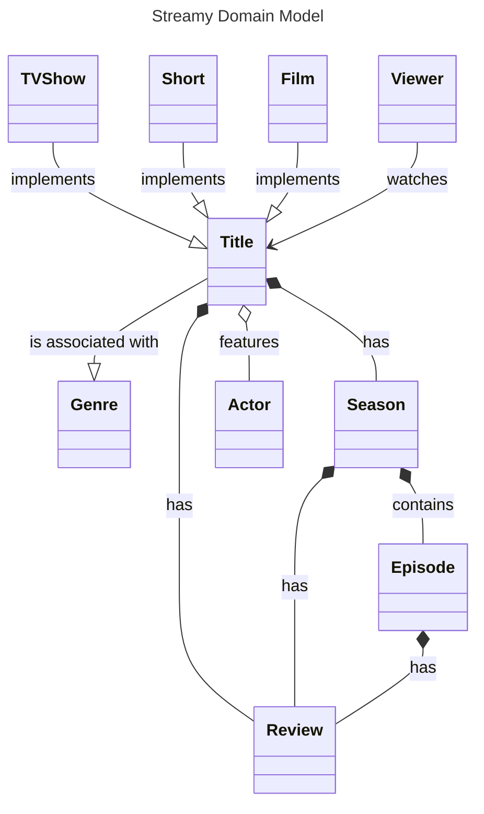
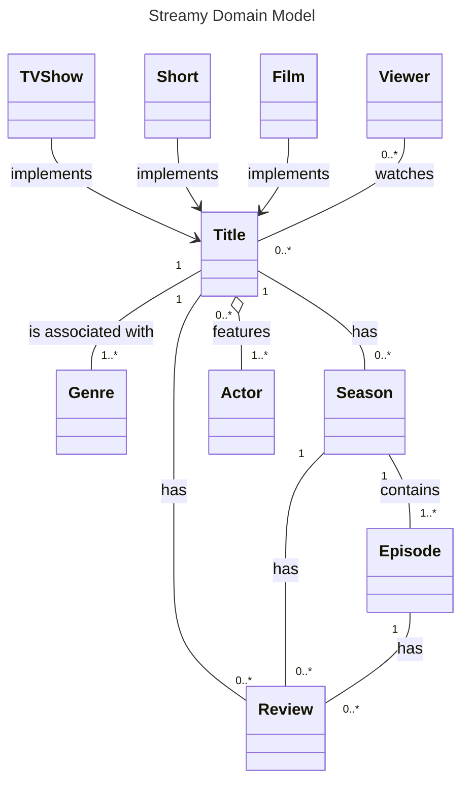
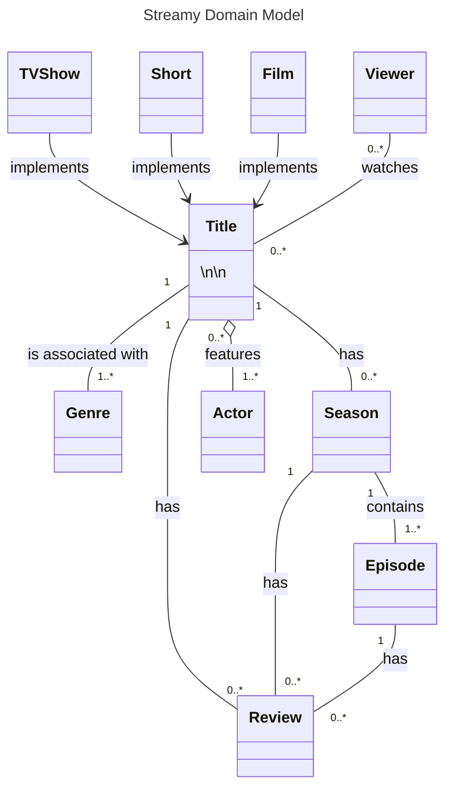

# Streamy Domain Model — Advanced UML Class Diagram

This document enriches the Streamy domain model with inheritance, relationship labels, multiplicity, and interactive hyperlinks.

## Step 1: Title and Generalizations (Inheritance)

Generalization (`--|>`) demonstrates that child entities are specialized subtypes of a parent entity.

## Step 2: Relationship Labels and Directional Association

Clarify how entities interact by appending a colon `:` followed by a description. Use `-->` for a directional association where only one entity retains a reference to the other.

## Step 3: Multiplicity (Cardinality)

Multiplicity denotes numerical bounds (e.g., "1", "0..*", "1..*").

## Step 4: Readability and External Links

Expand node height with `\n\n` and attach clickable URLs using the `link` keyword.

