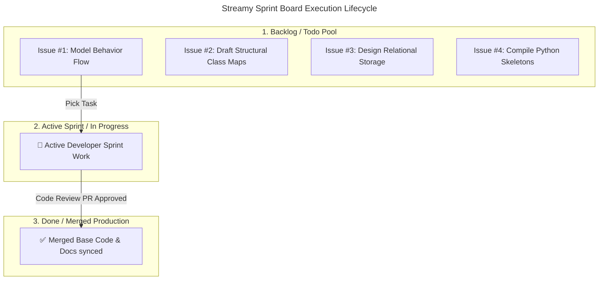

# Streamy Sprint Board Execution Lifecycle

This document models the Kanban sprint lifecycle for the Streamy project, mapping how decomposed tasks flow from the Backlog pool through active development to merged production.

